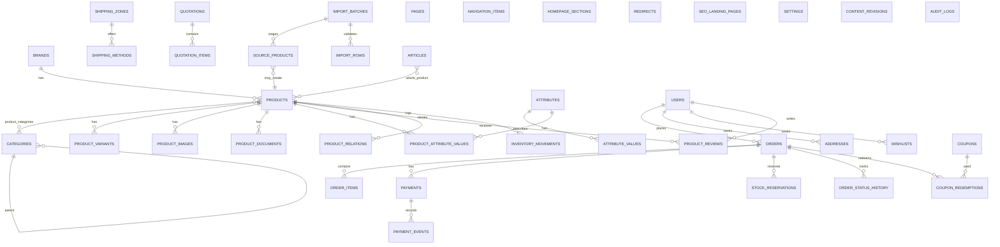

# Architecture and database

## Stack decision

- **Laravel 12.70 / PHP 8.2** — currently supported stable framework line, verified in this environment.
- **MySQL/MariaDB** — transactional catalogue, orders, payments, imports and CMS data. Local verification used MariaDB 10.4.32, a MySQL-compatible server.
- **Blade + Tailwind CSS 4 + Alpine.js** — server-rendered storefront and admin. Alpine is used only for lightweight enhancement (menu, gallery, autocomplete, checkout shipping refresh, consent). Public product content remains in the initial HTML.
- **Custom administration area** — selected instead of Filament for tight control over the editorial workflow, catalogue staged approval, money handling and permissions. It uses the same Blade/Tailwind stack and server-side Gate checks.
- **Livewire not used** — the required interactions are small and are better served by server-rendered forms plus minimal Alpine. The architecture does not depend on Livewire; it can be added later without changing domain services.
- **Vite** — production asset compilation.
- **Redis-ready, database-driver local default** — this build machine has no Redis extension, so `.env` uses database cache, queue and session. `.env.example` targets Redis for production. Switching is environment-only.

## Modular monolith boundaries

```
app/
├── Models/                    Eloquent entities with explicit relationships/casts
├── Services/
│   ├── PricingService         Integer minor-unit calculations, tax, discounts
│   ├── CartService            Session cart hydration and validation
│   ├── InventoryService       Reservations, commits, releases, adjustments
│   ├── CheckoutService        Transactional order placement and stock reservation
│   ├── Payments/              Gateway contract, M-Pesa, bank, disabled card adapter
│   ├── SearchService          MySQL relevance search and faceted filters
│   ├── SeoService             Titles, descriptions, canonical and robots decisions
│   ├── StructuredDataService  JSON-LD built from displayed data
│   ├── SitemapService         Canonical indexable URLs only
│   ├── Imports/               SSRF-guarded fetch, parser, staging, reconciliation
│   ├── ReviewService          Moderation and rating recalculation
│   ├── LinkAuditService       Internal link resolution report
│   └── ...                    Slugs, revisions, audit, TOTP, images, settings
├── Http/Controllers/
│   ├── Storefront/            Public read/write flows
│   └── Admin/                 Role-protected administration
├── Http/Middleware/           Admin, MFA, order access, redirects, staging, headers
├── Jobs/                      Payment reconciliation
└── Observers/                 Sitemap/menu/home cache invalidation
```

The boundaries are logical, not separate deployable services. There is no reason for microservices at this scale.

## Database diagram (major entities)



### Important schema choices

- **Money** is stored as integer minor units (`*_minor` / BIGINT). No floats in computation. `PricingService` performs integer/rounding operations. KES displays with no decimals when whole.
- **Tax** is configurable (`config/tajira.php`, DB settings). Product-level inclusive/exclusive override. Order lines store tax mode and tax amount. Shipping is currently not taxed; this must be confirmed by the business/tax adviser.
- **Categories** are nested with a separate primary category on products for breadcrumbs. Many-to-many assignments are supported. Brands are separate entities, never category branches.
- **Attributes** are typed (`select`, `number`, `boolean`, `text`) with optional units and filter/comparison/search flags. Filtering never relies on a free-text specification blob.
- **Variants** have their own SKU, price, stock and option JSON. Product-level effective price falls back to the product.
- **Inventory** keeps `stock_quantity` (on hand) and `reserved_quantity`; available = difference. Reserving increments reserved under `SELECT ... FOR UPDATE`; commit decrements both and writes a movement; release decrements reserved only.
- **Reservations** expire after the configured window. The scheduler releases expired reservations and cancels unpaid orders. Late successful payments are recorded as `payment_exception` and never silently commit stock.
- **Payments** are separate attempts. Provider references and event IDs are unique. Payment success requires matching amount and currency; M-Pesa callbacks are additionally checked through the STK query API where configured.
- **Imports** separate source observations (`source_products`, `import_rows`) from approved product records. Competitor prices/stock are reference observations only. Approval creates empty drafts and never copies descriptions or prices.
- **SEO** fields live on content entities; redirects are managed rows. Collections are admin-approved landing pages, not arbitrary filter URLs.
- **Audit/revision** records preserve administrative changes and content snapshots.

## Request flows

### Order placement

1. Cart hydrates published products and variant availability from the session.
2. Checkout validates contact/address/payment inputs and the checkout token.
3. `CheckoutService` obtains a cache lock, opens a DB transaction, locks products/variants, recalculates prices/tax/coupon/delivery server-side, creates order/items, reserves stock, records coupon use and history.
4. The cart is cleared only after the transaction commits.
5. Payment initiation happens outside the order transaction. Bank transfer is pending manual verification; M-Pesa starts an STK push.
6. Only a verified server-side payment result marks the order paid and commits stock. A browser redirect is never sufficient.

### M-Pesa callback

1. Callback payload is parsed and a unique `payment_events` row is created (idempotency).
2. Payment is matched to `CheckoutRequestID`; amount/currency are checked against the order.
3. The STK query API is used to confirm success where available. If confirmation is pending, the callback is acknowledged and reconciliation is queued.
4. On success, payment and order are locked, amount rechecked, stock committed, and history written.
5. Repeated callbacks return duplicate/pending without double-committing stock.
6. Failed/uncertain payments do not mark the order paid.

### Cache invalidation

`ContentCacheObserver` clears header/footer brand/menu/home caches and sitemap caches when catalogue/content changes. Settings changes flush the settings cache. Product/price/stock changes update sitemap lastmod via `updated_at` (stock changes currently update the product row through inventory operations where applicable; pricing publication changes always save the product).

## Roles and authorisation

`config/permissions.php` defines the role/ability matrix. Gate definitions are registered in `AppServiceProvider`; `User::hasAbility()` is the source of truth. Controllers call `$this->authorize(...)`. Admin middleware additionally requires an active administrator and enforces MFA challenge where enabled. The server rejects unauthorized actions even if a menu item is hidden.

## Security architecture

- Server-side validation and policies; least-privilege roles.
- CSRF protection, password hashing (bcrypt), secure session regeneration, login/search/checkout/review/quote rate limits.
- Admin TOTP MFA and emergency reset command; audit logs.
- HTML sanitisation allowlist for rich content.
- Image upload validation and WebP re-encoding; PDF-only documents; no SVG upload.
- Import fetcher: HTTPS-only, host allowlist, DNS/IP private-range blocking, redirect revalidation, response-size limit, content-type restriction, crawl throttle, user agent.
- Security headers, noindex on private routes, staging Basic Auth option, HTTPS/HSTS when secure.
- Secrets remain in environment variables; payment request payloads redact passwords/tokens.
- Customer data export and deletion-request workflow; anonymisation command for approved cases; retention policy remains configurable and legally reviewable.

## Deployment topology

A single Laravel application + MySQL + Redis + queue worker + scheduler is sufficient. Static assets are CDN-ready. No microservices, websocket server, or separate search cluster is required for the first release. MySQL full-text/relevance search is implemented with a documented future path to Meilisearch/OpenSearch if catalogue growth demands it.

## Deliberate limitations

- No eTIMS integration; no tax-compliance claim.
- No card gateway implementation; the adapter is disabled and refuses payment.
- No automated AI content generation/publishing. Editorial drafts require human review.
- No automated image rights acquisition. Images must be authorised.
- No claim that all reference products were imported. See the audit.
